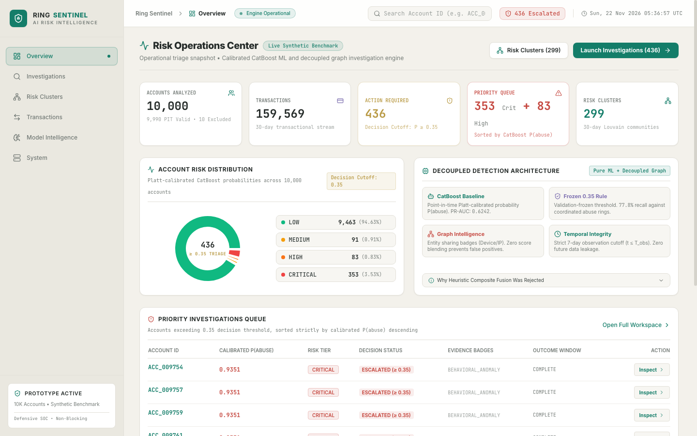
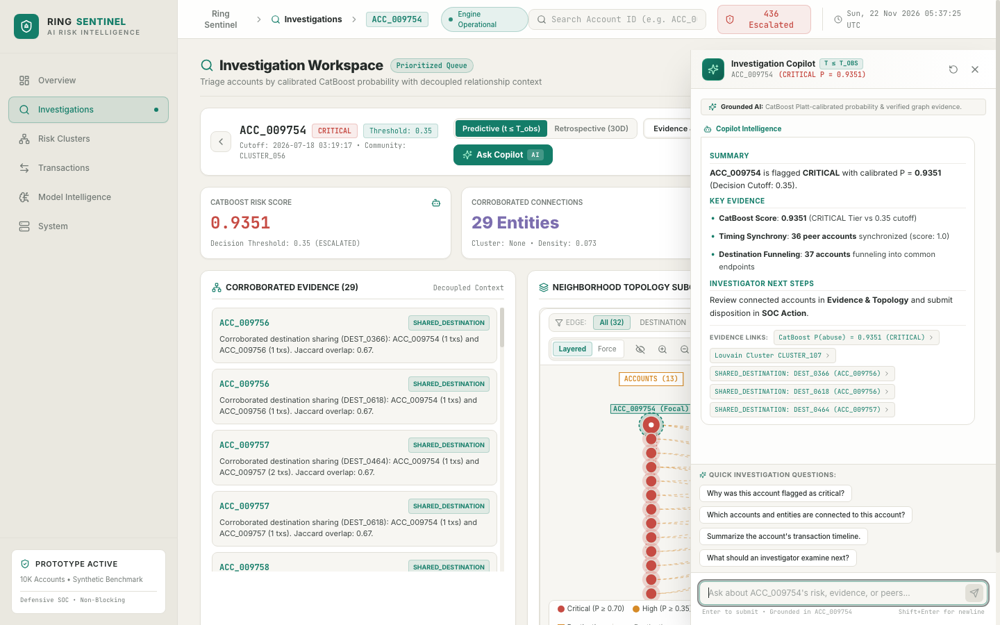
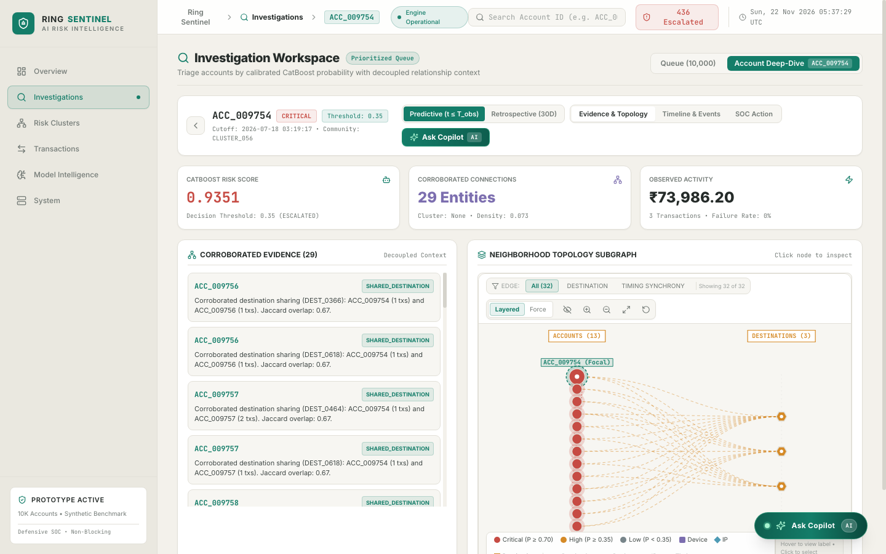
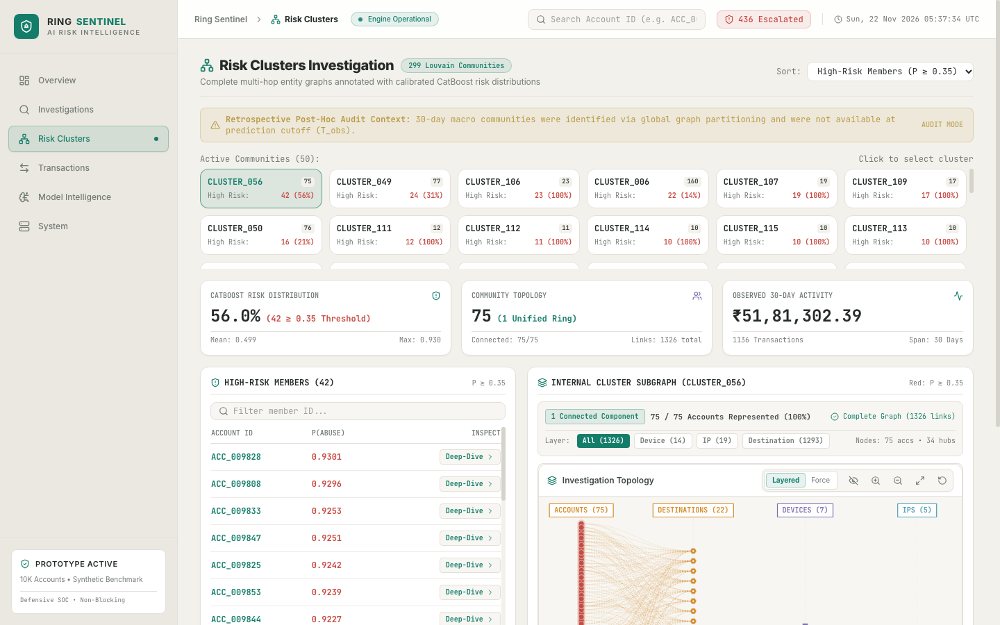
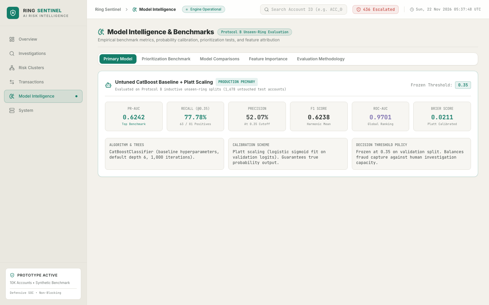
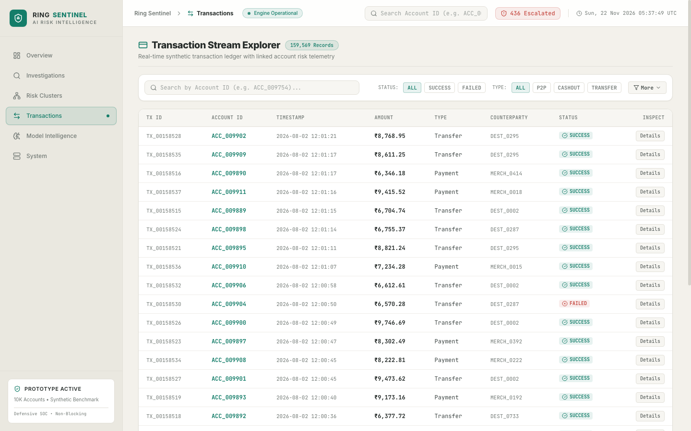
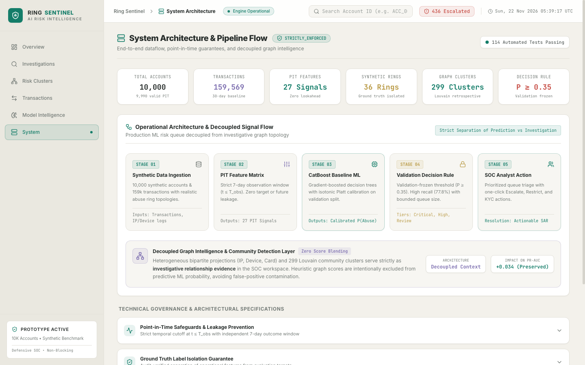

# Abuse-Ring Sentinel: AI Risk Intelligence Platform

[](https://www.python.org/)
[](https://fastapi.tiangolo.com/)
[](https://react.dev/)
[](https://catboost.ai/)
[](#-automated-testing)
[](#-key-capabilities--architectural-highlights)

**Abuse-Ring Sentinel** is an enterprise-grade fintech AI Risk Intelligence & Security Operations Center (SOC) detection platform designed to detect coordinated abuse rings, collusive transaction networks, and multi-accounting clusters across seemingly independent user accounts.

Built for the **Razorpay AI Builder Buildathon**, the platform integrates point-in-time supervised machine learning, heterogeneous bipartite graph topology, temporal synchronization analysis, and an evidence-grounded **AI Investigation Copilot** into an explainable, non-blocking risk scoring ecosystem.

---



---

## 🌟 Key Capabilities & Architectural Highlights

### 1. Decoupled Risk Intelligence Engine
* **Primary Predictive Model**: CatBoost baseline with Platt scaling calibration ($P \in [0, 1]$, PR-AUC: `0.6242`, ROC-AUC: `0.9701`) evaluated under strict Protocol B unseen-ring inductive splits.
* **Validation-Frozen Threshold (0.35)**: Optimized on validation data under synthetic operational cost trade-offs, capturing **77.8% of coordinated rings** while bounding the priority triage queue to **436 accounts (4.36% of population)**.
* **Pure Calibrated Probability Ranking**: Triage queues are prioritized strictly by calibrated probability. Heuristic composite score blending was empirically rejected to eliminate false-positive score contamination.
* **Decoupled Graph Intelligence**: 299 retrospective Louvain macro-communities and point-in-time entity subgraphs serve strictly as human investigation context, never blended into ML probabilities.

### 2. Context-Aware AI Investigation Copilot
* **Zero-Hallucination Grounded Architecture**: The Copilot does not invent transactions, alter CatBoost probabilities, or hallucinate entities. All responses derive strictly from point-in-time feature telemetry and verified graph evidence.
* **Built-in Local Forensic Intelligence Engine**: Operates instantly out-of-the-box in ~10ms with **zero external API keys, zero cost, and zero network latency**, while supporting optional Google Gemini (`GEMINI_API_KEY`) and OpenAI (`OPENAI_API_KEY`) adapters.
* **Straight-to-the-Point Forensic Briefings**: Compact 3-bullet triage cards explaining calibrated risk tier, observable drivers (timing synchrony, funneling, device/IP footprints), and actionable SOC next steps.
* **Interactive Floating Copilot Trigger**: Unobtrusive floating action button (`fixed bottom-6 right-6`) with active emerald glow and 1-click suggested investigation chips.

### 3. Strict Ground-Truth Isolation & Temporal Integrity
* **Point-in-Time Boundaries ($t \le T_{obs}$)**: Enforces strict 7-day observation cutoffs with zero future-outcome leakage.
* **Defensive Non-Blocking Protocol**: Actionable tiering (`LOW`, `MEDIUM`, `HIGH`, `CRITICAL`) that routes high-risk cases to human review queues rather than disruptive auto-blocking.
* **Synthetic Label Exclusion**: Operational API endpoints and dashboard views strictly exclude ground-truth labels (`ring_id`, `account_type`), reflecting real-world zero-knowledge deployment.

### 4. Deterministic Layered Bipartite Topology Graph
* **4-Column Layered Projection**: Accounts grouped by risk tier on the left; counterparty destinations, shared devices, and subnet IPs degree-ranked on the right with horizontal cubic Bezier curves.
* **Interactive Canvas Controls**: Dynamic zoom, pan, edge filtering (timing synchrony, shared destination, hardware), and node inspector drawer with complete entity audit trails.

### 5. Warm Neutral + Emerald Design System
* **Premium Enterprise Visual Theme**: Designed with Warm Ivory (`#F3F1EB`), Crisp Card White (`#FFFFFF`), Soft Stone (`#EAE8E0`), and semantic risk tiers (Critical: `#C64B43`, High: `#D58A27`, Medium: `#B99A45`, Low: `#78858A`, Operational: `#147D69`).

---

## 📸 Platform Tour & Core Views

### 1. Risk Operations Center (Overview)
Executive command center displaying point-in-time platform KPIs, risk distribution donut chart, decoupled architecture summaries, and high-priority accounts requiring immediate human triage.


---

### 2. Investigation Workspace & AI Copilot
Analyst triage queue filterable by risk tier and shared infrastructure, paired with point-in-time account telemetry, 1-hop neighborhood topology subgraphs, and the **AI Investigation Copilot** delivering instant forensic explanations and suggested prompt chips.



*Workspace with closed Copilot showcasing the floating trigger and interactive topology:*


---

### 3. Coordinated Risk Clusters (Louvain Communities)
Multi-hop macro-community explorer mapping 299 Louvain clusters across 30 days. Includes a 4-column deterministic layered bipartite graph layout, high-risk member ranking, and internal cluster subgraphs.



---

### 4. Model Intelligence & Empirical Benchmarks
Comprehensive evaluation hub displaying Protocol B unseen-ring test metrics, CatBoost vs. benchmark comparisons (XGBoost, Balanced Random Forest, Logistic Regression), Platt scaling calibration curve, and feature importance attribution.



---

### 5. Transaction Stream Explorer
Audit-ready ledger covering 159,569 transactions across 10,000 accounts with counterparty resolution, transaction status badges, time filters, and full text search.



---

### 6. System Architecture & Pipeline Flow
Complete end-to-end dataflow visualization illustrating data ingestion, point-in-time feature extraction, CatBoost scoring, decoupled graph intelligence, and defensive human review workflows.



---

## 🚀 Quickstart: Running the Platform

### Prerequisites
* **Python 3.9+** with virtual environment (`.venv`)
* **Node.js 18+** and npm (only needed if compiling the frontend from source)

### Option 1: Unified Server (FastAPI + Pre-Built Frontend) — Recommended

Launch the unified server serving both the REST API and the compiled React frontend on `http://127.0.0.1:8000`:

```bash
# 1. Activate the python virtual environment
source .venv/bin/activate

# 2. Launch the dashboard server
python dashboard/run_dashboard.py
```
*(On macOS/Linux if `python` is not aliased to your venv, run `.venv/bin/python dashboard/run_dashboard.py` or `python3 dashboard/run_dashboard.py`)*

Open your browser and navigate to: **`http://127.0.0.1:8000`**

### Option 2: Live Development Mode (Vite Hot-Reload)

If you are developing frontend features with live hot-reloading:

```bash
# Terminal 1: Launch FastAPI backend
source .venv/bin/activate
python src/api/server.py

# Terminal 2: Launch Vite dev server
cd dashboard/frontend
npm run dev
```

Navigate to: **`http://localhost:3000`**

---

## 🤖 AI Investigation Copilot Configuration

The AI Investigation Copilot defaults to the **Built-in Local Forensic Engine**, which requires **zero API keys** and responds in ~10ms.

If you wish to enable Google Gemini or OpenAI as external providers:

1. Copy the environment template:
   ```bash
   cp .env.example .env
   ```
2. Set your preferred provider and API key in `.env`:
   ```bash
   COPILOT_PROVIDER=gemini
   GEMINI_API_KEY=your_google_gemini_api_key_here
   # or
   COPILOT_PROVIDER=openai
   OPENAI_API_KEY=your_openai_api_key_here
   ```
3. Restart the dashboard server.

---

## 📂 Project Directory Structure

```text
abuse-ring-sentinel/
├── data/
│   ├── raw/                       # 10K accounts, 159K transactions
│   └── processed/
│       ├── account_features_pit.csv # Point-in-time feature matrix (27 signals)
│       ├── ground_truth_pit.csv   # Isolated ground-truth labels
│       ├── graph_clusters.csv     # Detected Louvain community clusters
│       ├── model_results/         # CatBoost & benchmark evaluation artifacts
│       └── risk_results/          # Account & cluster risk score allocations
├── src/
│   ├── api/                       # FastAPI REST API (server.py)
│   ├── copilot/                   # AI Investigation Copilot service, providers & prompts
│   │   ├── config.py              # Provider auto-detection & environment loader
│   │   ├── context.py             # Point-in-time evidence context builder
│   │   ├── prompts.py             # Guardrails & system prompt specifications
│   │   ├── provider.py            # Local forensic engine + Gemini/OpenAI adapters
│   │   └── service.py             # Async Copilot orchestration & chat API
│   ├── data_generation/           # Synthetic accounts & transaction stream generator
│   ├── features/                  # Vectorized point-in-time feature engineering
│   ├── graph/                     # Bipartite projection & Louvain community detection
│   ├── models/                    # CatBoost training, Platt calibration & benchmarks
│   ├── scoring/                   # Risk engine & threshold freezing logic
│   ├── investigation/             # Evidence extraction, cluster summarizer & queue prioritizer
│   └── evaluation/                # Protocol A (OOT) & Protocol B (Unseen Ring) benchmarks
├── dashboard/
│   ├── frontend/                  # React + Vite + TailwindCSS + Lucide + Recharts
│   │   ├── src/
│   │   │   ├── components/copilot/ # Floating AI Copilot drawer & chat UI
│   │   │   ├── components/graph/   # HTML5 Canvas Bipartite topology graph
│   │   │   └── pages/             # Overview, Investigations, Clusters, Models, System
│   └── run_dashboard.py           # Unified launcher script
├── docs/
│   └── images/                    # High-resolution screenshots for GitHub documentation
├── tests/                         # 114 automated unit & integration test suites
├── requirements.txt
└── README.md
```

---

## 🧪 Automated Testing

The platform includes **114 automated unit and integration tests** validating data generation, point-in-time features, graph projections, CatBoost calibration, API endpoints, and the AI Investigation Copilot:

```bash
# Activate virtual environment
source .venv/bin/activate

# Run the complete test suite
pytest tests/
```

**Test Suite Coverage Summary:**
* `tests/test_api.py`: FastAPI endpoints, CORS, query parameters, error responses (11 tests).
* `tests/test_copilot.py`: AI Copilot context building, local provider, citations, prompt injection defenses (18 tests).
* `tests/test_benchmarks.py`: Protocol B inductive evaluation, model catalogs (6 tests).
* `tests/test_data_generation.py`: Deterministic seeds, synthetic topology integrity (4 tests).
* `tests/test_end_to_end_eval.py`: End-to-end pipeline execution and artifact validation (7 tests).
* `tests/test_evaluation_integrity.py`: Temporal isolation ($t \le T_{obs}$) and label leakage audits (12 tests).
* `tests/test_features.py`: Point-in-time feature calculations and vectorization (6 tests).
* `tests/test_graph.py`: Bipartite projections, Louvain modularity, degree ranking (8 tests).
* `tests/test_investigation.py`: Evidence extraction, timeline reconstruction, queue prioritization (19 tests).
* `tests/test_models.py`: Model training, calibration, threshold freezing (7 tests).
* `tests/test_risk_engine.py`: Cost-sensitive threshold tuning, risk tier allocations (12 tests).

**Result**: `114 passed in ~22s (100% pass rate)`

---

## 🛡️ License & Acknowledgments

Developed as a defensive financial intelligence reference architecture for the **Razorpay AI Builder Buildathon**. All benchmarks derive from synthetic graph and transaction distributions modeled after real-world payment abuse syndicates.
